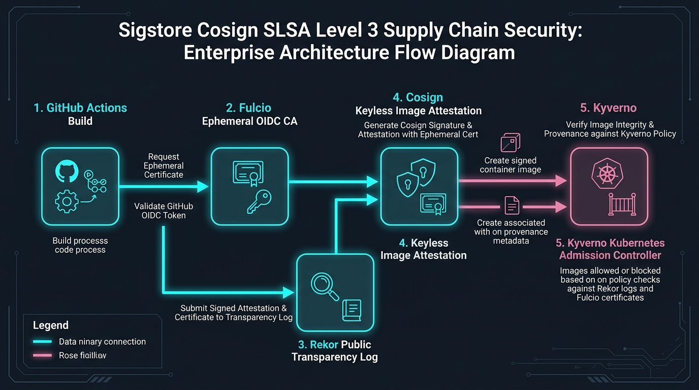

# Sigstore Cosign SLSA Provenance Studio

[](https://github.com/Pradeeptalari14/tp-sigstore-cosign-slsa/actions)
[](LICENSE)
[](https://talaripradeep.info/tools/sigstore-cosign-slsa/)
[](https://talaripradeep.info/studios/flow/?studio=sigstore-cosign-slsa)

> **Author:** [Talari Pradeep](https://talaripradeep.info) — Senior SRE & Platform Architect  
> **Interactive Studio Workspace:** [https://talaripradeep.info/tools/sigstore-cosign-slsa/](https://talaripradeep.info/tools/sigstore-cosign-slsa/)  
> **Visual Flow Canvas DAG:** [https://talaripradeep.info/studios/flow/?studio=sigstore-cosign-slsa](https://talaripradeep.info/studios/flow/?studio=sigstore-cosign-slsa)  
> **Documentation Guide:** [https://talaripradeep.info/tools/sigstore-cosign-slsa/learn.html](https://talaripradeep.info/tools/sigstore-cosign-slsa/learn.html)

---

## 1. System Architecture Flow



### Architectural Highlights
Automate SLSA Level 3 build provenance, in-toto cryptographic attestations, and keyless container image signing using GitHub Actions OIDC and Rekor transparency log.

* **Cryptographic Provenance:** Guarantees tamper-proof software supply chain attestation before deployment.
* **Deterministic Policy Gates:** Continuous enforcement against unauthorized container digests, bad dependencies, or untrusted inputs.
* **Zero Static Secrets:** Ephemeral identity validation avoiding long-lived bastion credentials.

---

## 2. Infrastructure & Software Technology Stack

| Category | Technology | Architectural Role |
| :--- | :--- | :--- |
| **Signing & Identity** | `Sigstore Cosign 2.4`, `GitHub Actions OIDC v1`, `Fulcio Ephemeral CA` | Enterprise verification & telemetry |
| **Transparency & Ledger** | `Rekor Public Transparency Log`, `in-toto Attestation Predicate v1`, `RFC 3161 Timestamping` | Enterprise verification & telemetry |
| **Kubernetes Admission** | `Kyverno 1.12 Policy Controller`, `OPA Gatekeeper Provider`, `Distroless Non-Root Base` | Enterprise verification & telemetry |

---

## 3. Primary Specification Manifest: `cosign-attestation.yml`

```yaml
apiVersion: v1
kind: SigstoreCosignPipeline
metadata:
  name: sigstore-cosign-slsa
spec:
  oidcProvider: "https://token.actions.githubusercontent.com"
  rekorTransparencyUrl: "https://rekor.sigstore.dev"
  fulcioCertificateAuthority: "https://fulcio.sigstore.dev"
  slsaProvenanceLevel: 3
  signKeyless: true
  attestationPredicate: "https://slsa.dev/provenance/v1"
```

---

## 4. Quickstart & Local Verification

### A. Clone and Validate
```bash
git clone https://github.com/Pradeeptalari14/tp-sigstore-cosign-slsa.git
cd tp-sigstore-cosign-slsa

# Execute SRE validation drill
chmod +x scripts/validate.sh
./scripts/validate.sh
```

### B. Run Implementation Automation
```bash
python3 main.py
```

---

## 5. Kubernetes & Docker Deployment

### Docker Run
```bash
docker build -t tp-sigstore-cosign-slsa:latest .
docker run --rm tp-sigstore-cosign-slsa:latest
```

### Kubernetes Admission Policy
```yaml
apiVersion: kyverno.io/v1
kind: ClusterPolicy
metadata:
  name: check-image-slsa-attestation
spec:
  validationFailureAction: Enforce
  rules:
    - name: verify-cosign-signature
      match:
        any:
          - resources:
              kinds: ["Pod"]
      verifyImages:
        - imageReferences: ["ghcr.io/pradeep/*"]
          attestors:
            - entries:
                - keyless:
                    issuer: "https://token.actions.githubusercontent.com"
                    subjectRegExp: ".*@github\.com"
                    rekor:
                      url: "https://rekor.sigstore.dev"
```

---

## 6. SRE Runbook & Operational Verification

* **Verify Signatures & Telemetry:**
  ```bash
  cosign verify --certificate-identity-regexp '.*@github\.com' ghcr.io/pradeep/service:latest
  ```
* **Audit Rekor Transparency Log:**
  ```bash
  rekor-cli search --sha <IMAGE_SHA256_HASH>
  ```

---

## 7. License

Licensed under the [MIT License](LICENSE). Copyright (c) 2026 Talari Pradeep.
